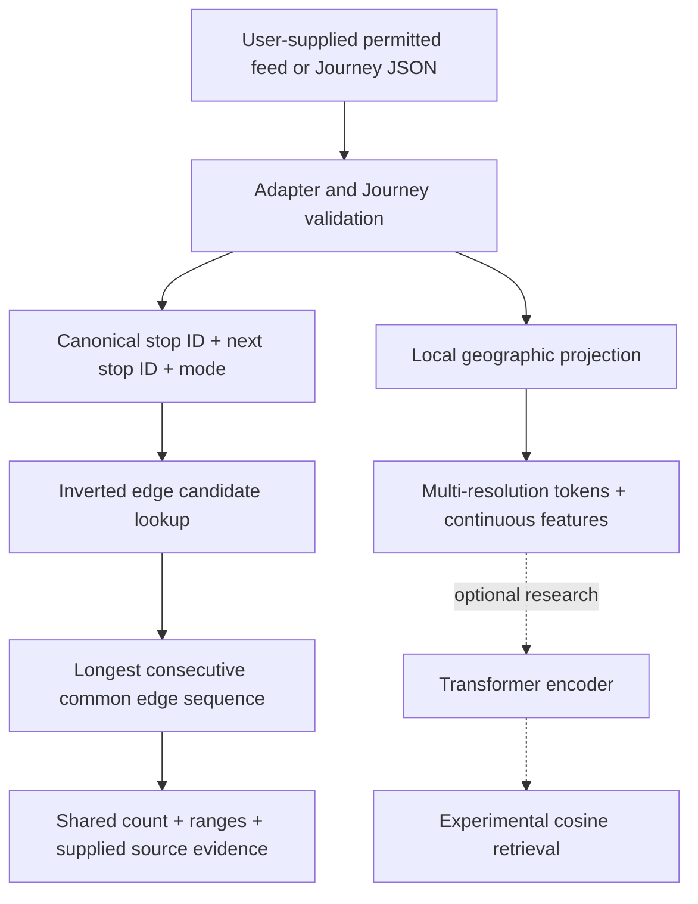

# Architecture and actual guarantees

DJGtok represents an ordered transit pattern as a sequence of directed edges. Its public core has two independent uses: geographic feature tokenization for experiments, and exact shared-corridor matching when canonical stop IDs are available. **The exact matcher does not run the tokenizer or a trained model.**

## Interchange and source adapters

`Stop` carries a nonblank provider-scoped `id`, numeric latitude and longitude, and optional JSON-valued source fields. `Journey` carries 2–512 ordered stops, one mode and one line ID per consecutive pair, a source label and metadata. Coordinates must be finite and bounded. Modes are `walk`, `bus`, `rail`, `subway`, `tram`, `ferry`, or `other`. These are planned or supplied sequences, not evidence that a passenger can make the journey on a particular day.

Validation rejects mismatched array lengths, duplicate dataset journey IDs, malformed source-row arrays, non-JSON metadata and out-of-bounds coordinates. It does not silently truncate oversized routes. Source provenance is supplied by the caller; the schema can check its consistency, not its truth. `subjourney` and `reverse_journey` isolate mutable stop objects and nested metadata. A reverse is marked synthetic and loses forward timetable/boarding fields.

The GTFS adapter reads a local ZIP, streams CSV tables, and sorts `stop_times` through temporary SQLite so input file order cannot change a trip's stop order. It checks route/service/stop references, numeric coordinates, sequence uniqueness, time syntax and boarding restrictions. Repeated scheduled trips collapse into patterns identified by route, direction, ordered stops and pickup/dropoff rules. Calendar data is retained only to validate referenced service IDs; operational availability is not computed. Namespaces prefix provider stop and line identities. Trips with MBTA reference-service typicality `6` are explicitly excluded when that optional extension is present.

The Seoul adapter reads the specific OA-1095 workbook columns and preserves source row numbers. It sorts each route by sequence, retaining repeats. Invalid or incomplete routes are reported and excluded as whole routes. It does not infer missing intermediate stops or split a route into inbound/outbound service when the source does not mark those boundaries. Imported longitude/latitude values must be checked against the provider's coordinate documentation for each new source.

## Exact corridor matching

An edge is `(from_stop_id, to_stop_id, mode)`. Route/line names, coordinates and line IDs do not participate in equality. The same two stops in reverse order form a different edge. Two bus lines can share a bus corridor; a bus edge and a rail edge are different.

For each document, the matcher records positions where each edge appears. It scans query edges in order and extends a run only when the previous query edge matched the previous document position. This is a sparse longest-common-substring calculation over edge tuples, preserving loops and repeated edges. Disconnected matches are never added together. For equal maximal runs, the earliest query start, then earliest document start wins. A worst-case repeated-edge pair still takes O(query edges × document edges) work; this is not an approximate nearest-neighbor index.

`OverlapIndex` snapshots each validated journey and builds an inverted map from edge to candidate journey IDs. Searching unions candidates for the query's edges, applies explicit ID exclusions, computes exact runs, and retains runs above `min_shared_edges`. It ranks by shared edge count, query coverage, document coverage, then lexicographic journey ID. Coverage is count divided by that input's edge count. For one fixed query, query coverage ties whenever shared count ties; document coverage then favors a document whose route is more fully shared.

The score is an integer edge count, not cosine similarity, distance, duration or a probability. A match with `k` edges returns half-open stop ranges containing `k + 1` stops. Zero overlap returns `None` ranges; search returns no zero-overlap hits. Each returned hit copies the matching stops, modes, line IDs and available source references. Changing caller-owned data after index construction does not change the indexed corpus.

This guarantee depends on canonical IDs. Equal names, coordinates or tokens do not establish a shared stop. Renaming every stop into a different namespace removes exact matches unless an independently justified crosswalk is applied first. Matching consecutive stops also does not establish shared road geometry, express stopping behavior, transfer feasibility or pickup permission for a particular passenger.

## Geographic tokenizer

`TransitTokenizer.fit(training_journeys)` computes the mean latitude/longitude origin and a vocabulary from the supplied training set only. For an evaluation, split route families before fitting. Configuration and vocabulary are immutable. Versioned JSON serialization and a canonical SHA-256 fingerprint preserve the mapping; no Torch or pickle is needed.

Coordinates use a local equirectangular approximation: longitude offset × 111,320 × cosine(origin latitude), and latitude offset × 111,320, in approximate meters. This is a local representation, not a global map projection or road map matcher. Fit and validate a tokenizer for each region; antimeridian crossings, polar regions and cross-continent comparisons are not validated.

For each consecutive pair, compute midpoint, displacement, approximate distance and a 16-bin heading. At the default 200, 800 and 3,200 meter grid resolutions, a token contains `resolution:grid_x:grid_y:heading:mode`. Frequent tokens receive IDs beginning at 2, with deterministic lexical tie handling. ID 0 is unknown/padding and ID 1 is reserved for masking. Unknown cells still keep continuous features.

Default output for `E` edges is:

| Output | Shape | Meaning |
| --- | --- | --- |
| Token IDs | `E × 3`, int64 | One directed spatial token per resolution |
| Features | `E × 42`, float32 | 24 Fourier position features, 11 numeric features, 7 mode indicators |

Fourier periods are 300, 900, 2,700, 8,100, 24,300 and 72,900 approximate meters, with sine and cosine for both midpoint coordinates. The other numeric features are midpoint x/y, displacement x/y, unit direction x/y, log distance, relative edge position, turn dot product, turn cross product and a transfer indicator. A transfer feature marks a change of line ID or mode; it does not verify a valid transfer. Stop IDs and absolute line identities are not embedded. Changing line identity uniformly does not alter the features.

## Optional neural experiment

The separate `djgtok.experimental` modules retain the project's own research implementation. They are not used by `OverlapIndex`, are not the original t2vec architecture, and are not advertised as a successful default shared-corridor search feature.

The default model averages the three token embeddings and adds a learned projection of the 42 features into 96 dimensions. Two pre-norm Transformer layers use four heads, 192-dimensional feed-forward layers, GELU and dropout 0.1. Masked mean pooling, LayerNorm and a linear layer produce a 128-dimensional L2-normalized vector. There is no decoder, learned position embedding or CLS token; relative position is already an input feature.

Training creates contiguous views of route patterns, slightly shifts positive boundaries, and includes synthetic reverse views. Directed ID-and-mode edge-set overlap gives soft multi-positive targets; set overlap does not encode contiguous length, which is one limitation of this objective. Token IDs are masked at 15% while continuous features remain visible. The objective is temperature-0.1 contrastive cross entropy; default AdamW uses learning rate 0.0003, weight decay 0.01 and gradient clipping 1. The historical run used 600 steps, 64 anchors per batch and selected step 550 by fixed validation loss.

The historical split uses a deterministic SHA-256 route-line group and a 70/15/15 bucket rule. Its internal prefix `transitvec-v1:` is intentionally retained for comparison with the earlier project; changing the public package name does not resplit the experiment. Route grouping does not guarantee all cross-route shared subpaths are unseen. The evaluation reports this limitation.

The historical evaluator's `directed_overlap` baseline compares directed stop-ID pairs and ignores modes. That definition is retained for reproducibility. Public `compare_routes` also requires mode equality. The Seoul snapshot is all bus, but these definitions differ on mixed-mode data; do not combine their metrics as if they were one protocol.

Experimental dense retrieval indexes full journeys and overlapping 4/8/16-edge windows, computes exact NumPy cosine scores, and takes a maximum per document. That maximum does **not** measure the longest shared corridor, so a short perfect match can beat a long one. Returned window ranges are a cosine witness, not an exact stop alignment. Stored indices include array/corpus checksums and a checkpoint fingerprint. The public implementation also detects later changes to model bytes, tokenizer or configuration and requires saving/rebuilding; it does not silently query a stale index.

See [benchmarks](benchmarks.md) for measured results and failed cases, [usage](usage.md) for entry points, and [history](history.md) for why exact matching became the default.
